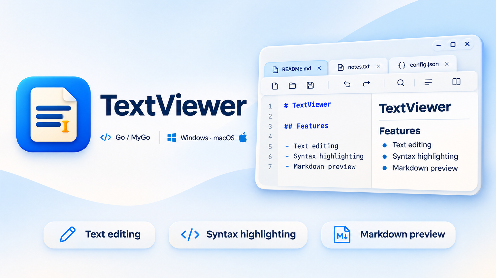

# TextViewer

[](https://awesomemygo.dev/apps/textviewer)



基于 Go / MyGo 的原生文本查看编辑器，支持 Windows 10 / Windows 11 和 macOS。Windows 支持 x64 / ARM64，macOS 使用同时支持 Apple Silicon 与 Intel 的 Universal 安装包。

## 功能

- 大文本后台载入、多文件标签、拖放打开、最近文件与清除记录、保存与另存为、撤销与重做。
- 自动换行、平滑滚动、字体与字号调整、字符统计；支持浅色、深色及中英文界面，记忆用户设置。
- 查找与替换支持正则、转义字符（如 `\n`）和分组替换；提供行编辑、排序、去重、空白清理及命名转换。
- 代码语法高亮、JSON 格式化、可开关的 Markdown 预览及双向滚动同步；Ctrl+点击 URL 在浏览器中打开。
- 两个已打开标签的只读文本对比、差异跳转；Base64 编码与解码支持选区、全文及一次撤销。
- UTF-8、UTF-8 BOM、UTF-16 LE/BE BOM、GB18030 编码，以及 CRLF / LF 保存格式切换。
- TXT、LOG、JSON、YAML 等常用文本关联及分类图标，Windows 11 新版右键菜单 / Finder 快速操作，以及带 SHA-256 校验的在线更新。
- Windows 可在“设置 → 选择后缀”中勾选文本和开发语言后缀，保存设置后生效；默认只选择常用文本。

## 下载

从 [Releases](https://github.com/Oranjekop/TextViewer/releases/latest) 下载。Windows 合并安装包自动选择 x64 / ARM64；便携版选择对应架构的 ZIP。macOS 选择 `macos-universal.pkg`，安装到 `/Applications`，无需区分芯片，要求 macOS 12 或更新系统。

文件关联和右键菜单在“设置”中勾选并保存，取消勾选后保存即可移除。Windows 11 右键集成使用签名的稀疏 MSIX 身份包，首次启用可能需要确认签名信任；安装包本身尚无公共 Authenticode 签名。

macOS 的右键入口位于 Finder“快速操作 / 服务”，必要时在系统设置中启用该扩展。文件关联注册到“打开方式”，默认应用由 Finder“显示简介 → 打开方式 → 全部更改”设置；系统可能自动重新发现应用的文档类型。macOS 默认构建采用临时签名，未公证的安装包可能受到 Gatekeeper 限制。

## 开发

需要 Go（版本见 `go.mod`）；Windows 构建使用 PowerShell，macOS 打包使用系统命令行工具。MyGo 等依赖由 Go Modules 管理。

```powershell
go run .
go test ./...
go vet ./...
go mod verify
```

主要代码：

| 目录 | 职责 |
| --- | --- |
| `internal/desktop` | 窗口、工具栏、多标签、设置、Markdown 预览与文本对比 |
| `internal/document` | 文档读写、编码转换、保存保护及 JSON 格式化 |
| `internal/search`、`internal/textops` | 查找替换、行操作、文本转换与 Base64 |
| `internal/fileassoc`、`internal/shellmenu`、`internal/macsystem`、`shell` | 文件关联、Windows 右键扩展与 Finder 快速操作 |
| `internal/update`、`internal/releaseinfo`、`internal/shellbundle` | 在线更新、发行元数据与内嵌集成资源 |
| `locales`、`assets`、`cmd/assets` | 中英文文案、图标母版及多尺寸资源生成 |
| `scripts`、`cmd/release` | 构建、安装包生成及集成回归 |

修改文案后生成中英文访问器；修改图标母版后重新生成资源：

```powershell
go run github.com/egoist/mygo/cmd/mygo generate
go run ./cmd/assets assets
```

文件格式清单统一维护在 `internal/filetypes/catalog.json`，工具栏 SVG 位于 `internal/desktop/icons`。

## 构建与发布

首次完整构建使用 `-BootstrapTools` 下载并校验 LLVM-MinGW 和 Windows SDK；发行构建还会准备 NSIS。

```powershell
# x64；输出 dist/TextViewer/windows-amd64
.\scripts\build.ps1 -BootstrapTools

# ARM64
.\scripts\build.ps1 -Architecture arm64 -BootstrapTools

# 双架构合并安装包、便携 ZIP 和 SHA256SUMS.txt
$tag = 'v' + (Get-Content mygo.json -Raw | ConvertFrom-Json).version
.\scripts\build-release.ps1 -Tag $tag -BootstrapTools
```

单架构目录中的 `TextViewer.exe` 已内嵌右键集成资源，可单文件分发；发行产物位于 `dist/release/<tag>`。可通过 `-CertificateThumbprint` 指定身份包的签名证书；如需给 EXE 添加 Authenticode 签名，应在资源内嵌完成后进行。

在 macOS 上生成一个 Universal `.pkg`，内含 arm64 和 x86_64；文档类型与高清 ICNS 图标从同一格式清单和母版生成：

```bash
bash scripts/build-macos.sh
```

可使用 `MACOS_SIGNING_IDENTITY`、`MACOS_INSTALLER_IDENTITY` 指定已有的 Developer ID 证书，使用 `MACOS_NOTARY_PROFILE` 指定钥匙串中已有的公证配置。未配置时不执行公证。

MyGo 会临时生成 `.syso`，同一工作目录内不要并行运行构建、测试和 vet。Windows 集成回归使用 `scripts/test-context-menu.ps1`；完整 EXE 构建后可运行 `scripts/test-shell.ps1`。

发布前添加 `docs/releases/<版本>.md`，提交代码并推送 `vMAJOR.MINOR.PATCH` 标签。GitHub Actions 自动测试、构建 Windows 合并安装包和 macOS Universal 安装包、检查安装包内容，并合并 SHA-256 清单后发布 Release。Windows 另有原生右键与隔离安装/卸载验收；main / PR 执行检查，macOS 同时验证打包。

## 性能与边界

- 文档驻留内存，不是磁盘分页编辑器；多个文件的内存占用累加。后台载入、流式查找和缓冲区复用减少阻塞及全文复制，复杂转换仍需要额外结果空间。
- 字符统计包含空格与换行，按 Unicode 码点计数；大文件后台统计，编辑后延迟重算，未完成时显示省略号，稳定帧复用缓存。
- Markdown 支持完整文档预览，编辑后延迟刷新并复用缓存；渲染和内存开销随文档大小和结构复杂度增加。
- 文本对比每侧上限 8 MiB、50,000 行；Base64 输入合计上限 32 MiB；JSON 格式化输入上限 128 MiB、预估输出上限 256 MiB。超限或处理失败不修改原文。
- 编码切换影响下次保存，不重新解读原文件；编辑区统一使用 LF，保存时按选定格式写入。

## 开源协议

本项目采用 [MIT License](LICENSE)。
