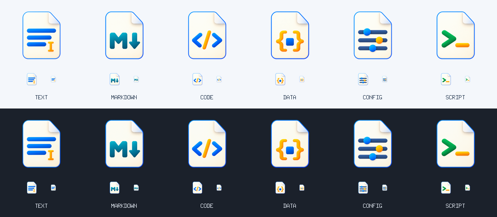

# TextViewer

使用 Go / MyGo 开发的原生文本查看编辑器，支持 Windows 10 / Windows 11（x64 / ARM64）。

## 功能

- 多选打开、拖入、编辑、保存和另存为文本；使用标签切换文件，分别保留光标、滚动位置、撤销记录及保存格式。
- 工具栏提供撤销和重做按钮；支持自动换行、字体和字号调整，重启后恢复上次选择的字体。
- “编辑”下拉菜单提供剪切、复制、粘贴、行复制/删除/移动/合并、缩进、排序、去重、空行与空白清理、大小写和命名转换、多光标选择、注释及转到行。
- 异步查找、上一处/下一处、替换和全部替换；支持区分大小写、正则表达式、转义字符和分组替换，替换可撤销。
- 按文件名识别 JSON、XML、Go、Python、JavaScript、TypeScript、HTML、CSS、SQL 等代码格式；右上角可手动选择语言或纯文本。
- 代码支持语法着色、缩进参考线和括号匹配；自动字体模式使用等宽字体，也可选择自己的字体。切换代码格式不重排文件内容。
- Markdown 支持可开关的右侧预览，编辑后自动刷新，左右分栏可拖动调整宽度。
- TXT、LOG 和未知扩展名默认纯文本，不为猜测格式扫描全文。打开新文件会恢复自动识别；手动选择仅用于当前文件。
- UTF-8、UTF-8 BOM、UTF-16 LE/BE BOM 和 GB18030；支持切换保存编码，以及 Windows (CRLF) / Unix、Linux (LF) 换行格式。
- JSON 格式化，使用两空格缩进，保留字段顺序、重复键、数字原文和转义；可一次撤销，错误 JSON 保持原样。
- 浅色、深色和跟随系统；上排 SVG 按钮包含悬浮提示和辅助功能名称。
- 简体中文和英文界面，默认跟随系统语言；可在设置中切换并记住选择，编辑区右键菜单同步翻译。
- 资源管理器右键命令“在 TextViewer 中打开”：Windows 10 使用原生右键菜单，Windows 11 使用新版右键菜单。
- 81 种常用文本、代码、数据、配置和脚本文件的“打开方式”关联，配套六类文件图标。
- 在线检查正式版本更新；下载安装前确认，下载后校验 SHA-256，安装前提示保存未保存的文本。

文件被外部程序修改、编码有损或文件只读时，不会直接覆盖原文件。混合 CRLF/LF 的文件由编辑器统一换行方式，不逐行保留混合换行。

## 使用

从 [最新正式发布页](https://github.com/Oranjekop/TextViewer/releases/latest) 下载 Windows 合并安装包。同一个安装程序自动选择 x64 / ARM64，按当前用户安装，无需为主程序申请管理员权限，提供开始菜单入口、可选桌面快捷方式及系统“已安装的应用”中的卸载入口。

需要便携使用时，下载对应架构的 ZIP，解压得到单个 `TextViewer.exe`，可直接复制、移动和运行。程序支持拖入文件，也可把文件路径作为启动参数。再次启动时，文件交给现有窗口打开；从开始菜单再次点击会激活现有窗口。

脚本、原生右键 DLL、MSIX 身份包及证书均打包在 EXE 内。正常启动不解包、不执行集成脚本。只有配置文件关联或右键菜单时，才会将所需资源释放到 `%LOCALAPPDATA%\TextViewer\Integration`；Windows 加载右键 DLL 时仍需要这个内部目录。全新安装目录仅包含 `TextViewer.exe` 和 `Uninstall.exe`。

安装程序目前没有公共 Authenticode 签名；不要把右键 MSIX 的自签名当作安装程序获得 Windows 公共发行商认证。

| 操作 | 快捷键 |
| --- | --- |
| 新建 / 打开 / 保存 | Ctrl+N / Ctrl+O / Ctrl+S |
| 另存为 | Ctrl+Shift+S |
| 关闭当前标签 | Ctrl+W |
| 下一个 / 上一个标签 | Ctrl+Tab / Ctrl+Shift+Tab |
| 查找 / 替换 | Ctrl+F / Ctrl+H |
| 下一处 / 上一处 | F3 / Shift+F3 |
| 关闭查找栏 | Esc |
| 自动换行 | Alt+Z |
| 增大 / 缩小字号 | Ctrl+加号 / Ctrl+减号 |
| 恢复 16 号字 | Ctrl+0 |
| 格式化 JSON | Ctrl+Shift+J |
| 打开 / 关闭 Markdown 预览 | Ctrl+Shift+V |
| 撤销 / 重做 | Ctrl+Z / Ctrl+Y |

查找栏可勾选“正则”或“转义字符”。“转义字符”支持 `\n` 换行、`\r` 回车、`\t` 制表符、`\\` 反斜杠，以及 `\0`、`\xNN`、`\uNNNN` 和 `\UNNNNNNNN`。两个选项都关闭时，查找和替换按字面处理反斜杠和美元符号。

正则模式自动启用转义，使用 Go 正则语法；`^` / `$` 匹配行首 / 行尾，`(?s)` 允许 `.` 跨行。替换支持 `$1`、`${1}`、`${名称}` 引用分组、`$0` 引用整个匹配、`$$` 插入美元符号；不支持环视或查找表达式中的反向引用。错误显示在查找栏，保留原文。

| 操作 | 模式 | 查找 | 替换 |
| --- | --- | --- | --- |
| 把逗号换成换行 | 转义字符 | `,` | `\n` |
| 把换行换成空格 | 转义字符 | `\n` | 一个空格 |
| 删除空白行 | 正则 | `^[ \t]*\n` | 留空 |
| 调整键值格式 | 正则 | `(?P<name>\w+)=(\d+)` | `${name}: $2` |

无论文件保存为 Windows CRLF 还是 Unix / Linux LF，`\n` 都能匹配文本换行；替换后仍按状态栏选定的换行格式保存。查找在后台流式读取文档，不为正则匹配复制全文或收集全部结果；全部替换会额外构造结果文本，应用前可取消，应用后可一次撤销。

打开对话框可一次选择多个文件，也可同时拖入多个文件或传入多个启动路径；已打开的文件会定位到已有标签。标签过多时可横向滚动，或从标签列表中选择。关闭有修改的标签时提示保存，退出或安装更新前逐一检查所有标签。

工具栏提供“保存”和“另存为”按钮。另存为可选择新的文件名和目录，保留当前编码、换行格式及文件扩展名，保存后当前标签指向新文件；原文件保持原样。

点击上排字体按钮可搜索系统字体并预览，应用后用于所有标签及之后打开的文件，重启后仍保留。选择“自动”恢复普通文本和代码各自的默认字体。字号继续在旁边的下拉框中调整。

Markdown 文件默认在右侧显示预览，点击标签栏右侧的分栏图标或按 Ctrl+Shift+V 可关闭或重新打开。滚动任一侧时，另一侧按 Markdown 内容位置同步跟随。拖动中间分隔线可调整左右宽度，各标签分别保留本次打开期间的预览开关、分栏比例和滚动位置。手动将“代码格式”设为 Markdown 也可预览，改为其他格式则隐藏预览。

预览支持标题、列表、任务列表、表格、引用、链接和代码高亮，文字可选择和复制。图片按文件所在目录解析本地路径；远程图片及超出加载限制的图片显示描述文字。另存为会更新图片的相对路径基准。

在“设置 → 界面语言”选择“跟随系统 / 简体中文 / English”，保存后立即生效；取消保留原语言。系统语言不在支持范围时使用英文。切换界面语言保留所有标签、正文、光标、撤销记录和保存格式。

点击工具栏的“编辑”下拉按钮使用行操作、空白处理、文本转换和选择功能。行复制、删除、移动、合并和缩进针对当前行或选中的行；排序、去重和空白处理有选区时针对所选的完整行，没有选区时处理全文。选区末尾位于下一行行首时，不包含下一行。

大小写及 `snake_case`、`kebab-case`、`camelCase`、`PascalCase` 转换处理所选文本；没有选区时处理光标所在单词。“反转所选文本大小写”需要先选择文本。行首空格转为制表符只改变缩进，保留正文中的空格；制表符宽度使用当前代码格式的设置，普通文本默认四列。排序、去重、空白清理及所选文本转换在后台计算，应用前可取消，应用后可一次撤销，并保留编码和换行格式。排序与去重需要额外的行索引和结果空间，大范围处理的内存开销随文本及行数增加。

点击状态栏编码或换行格式可修改保存格式。编码切换保留当前已解码的文本，以所选编码在下次保存时写入；不是以另一种编码重新解读原文件。只修改编码或换行格式也会标记为未保存。Windows 使用 CRLF，Unix 和 Linux 都使用 LF。

从“代码格式”菜单或编辑区右键选择“格式化 JSON”，也可按 Ctrl+Shift+J。该操作处理整个文档，只接受严格 JSON，不处理 JSONC 注释或 JSON5 语法。格式化在后台执行，可在应用结果前取消，保留当前编码和换行格式。输入上限 128 MiB，预估缩进输出上限 256 MiB；超过限制时保留原文。

### 文件关联与图标

点击右上角“设置”，勾选“关联常用文件格式”并保存，即可添加到 Windows“打开方式”。取消勾选后保存会移除 TextViewer 的关联注册；点击“取消”不改变系统设置。弹窗内也可打开 Windows 默认应用设置。

首次安装由用户在设置中选择是否启用文件关联和右键菜单。升级保留已有启用状态及保存的选择，取消勾选的功能不会在后续升级时自动恢复。

| 图标类别 | 常见格式 |
| --- | --- |
| 文本 | TXT、LOG、TEXT、NFO、LST |
| Markdown / 文档 | MD、MARKDOWN、RST、ADOC、TEX |
| 代码 | Go、Python、JavaScript、TypeScript、C/C++、C#、Java、Rust、SQL、HTML、XML、SVG、CSS、Vue 等 |
| 数据 | JSON、JSONC、JSON5、JSONL、NDJSON、CSV、TSV |
| 配置 | INI、CFG、CONF、CONFIG、ENV、YAML、TOML、PROPERTIES 等 |
| 脚本 | PowerShell、BAT、CMD、SH、BASH、ZSH、FISH、CMake、MK |



注册保留已有默认程序。需要双击使用 TextViewer 并显示配套文件图标时，在 Windows“默认应用”中选择相应格式，或从文件“打开方式”中选择 TextViewer 并设为始终使用。脚本关联也只打开编辑器。关联独立于新版右键包的签名信任。

文件图标内置于程序，包含 16–256 px 的十个尺寸；注册时随程序固定到本地集成目录，便携版原目录移动后仍可使用。关联操作只在安装、注册或移除时执行，不参与文档载入、编辑或每帧绘制。

### Windows 右键菜单

单个 EXE 已包含原生 COM 扩展、带签名的稀疏 MSIX 身份包及配套脚本。菜单命令支持单个或多个普通文件，不对文件夹或含文件夹的混合选择显示。

1. 打开“设置”，勾选“Windows 右键菜单”并保存。
2. Windows 10 直接注册当前用户的原生菜单，无需 MSIX 或证书信任。Windows 11 使用稀疏身份包；本机开发签名尚未受信任时，应用先询问是否继续，随后由用户决定是否接受 Windows 管理员确认。
3. 在资源管理器中选中一个或多个文本文件，右键选择“在 TextViewer 中打开”。
4. 在“设置”取消勾选“Windows 右键菜单”并保存，即可移除菜单。

本机签名信任仅导入指定的终端签名证书至 `LocalMachine\TrustedPeople`，不会导入根证书、开启开发者模式或更改 TXT 默认打开方式。开发证书私钥不会随包分发。正式分发可以在构建时指定已有代码签名证书。移除菜单不会删除系统中的证书信任。

注册时完整程序及图标固定到 `%LOCALAPPDATA%\TextViewer\Integration\bundles\app-<内容摘要>`，避免便携版目录被移动后菜单失效。升级重新绑定到当前版本，并清理不再使用的旧程序副本；仍在使用、被占用或包含用户新增文件的目录会保留。集成状态文件也保存在内部目录，不放在安装目录顶层。

安装包不会自动导入证书。兼容的受信任稀疏身份可继续用于新版程序，程序版本以实际运行的 EXE 为准。若升级后仍使用旧版右键目标，可在设置中关闭右键集成并保存，再重新启用。需要信任新签名时，应用会提示确认。

设置保存只应用有变化的勾选项。Windows 11 26H2 启用右键集成时会同时启用 TextViewer 的主菜单项。如果随后在系统“自定义菜单”中隐藏了 TextViewer，可在那里重新启用。其他应用及系统菜单显示设置保持原样。

### 在线更新

- 默认启动 3 秒后在后台检查，24 小时内最多自动检查一次；检查失败也会限频，不影响文本编辑。
- 从“设置 → 检查更新”随时手动检查，弹窗内显示等待状态和检查结果；发现新版后可选择安装。也可关闭“启动时检查更新”。仅检查 GitHub 上本仓库的正式 Release，不提供预发布或降级。
- 只有确认后才下载安装包。下载流式校验 SHA-256 清单及 GitHub 提供的摘要，失败或取消会删除未完成文件；执行前再次校验文件。
- 安装前提示保存修改，然后打开交互式安装程序。安装程序不会强制关闭仍在运行的 TextViewer；更新便携版时会安装到常规安装目录。
- 检查超时为 15 秒，元数据上限 2 MiB；安装包上限 256 MiB，下载进度最多每 200 ms 更新一次，不扫描或复制正在编辑的全文。

## 大文件与性能

文本存放于分块、持久化的编辑缓冲区，编辑、查找和保存不依赖每次复制全文的 UI 字符串。文件载入后仍驻留内存，不是无限大小的磁盘分页编辑器。

多个文件按顺序在后台载入，避免同时解码大文件产生内存峰值。标签切换复用原有缓冲区和编辑器状态，不重新读取或复制正文；同时打开文件的内存占用会累加。

输入保护上限为 2 GiB；这不等于已验证任意 2 GiB 文件。已实测约 100 MiB 的多行 TXT 和 JSON。单行超过 10,000 UTF-8 字节时跳过着色并重置后续词法状态，避免超长压缩代码的高亮开销；仍保留原文。极长单行的布局成本不在多行样本的保证范围内。

2026-11-02，本机 CPU 离屏渲染测试：

| 项目 | TXT，100 MiB / 819,201 行 | JSON，约 100 MiB / 1,028,100 行 |
| --- | ---: | ---: |
| 打开 | 558 ms | 478 ms |
| 载入后新增保留堆，不含后续 UI 索引 | 108.8 MiB | 105.0 MiB |
| 稳态重绘 | 0.40 ms | 0.40 ms |
| 输入一个字符 | 5.5 ms | 8.5 ms |
| 全文无匹配查找 | 1.34 s | 1.27 s |
| 保存 | 625 ms | 1,054 ms |

TXT 自动换行索引在初始测试批次后渐进完成，另用约 1.39 s。相同 TXT 样本开启换行的首批离屏帧约 120 ms，关闭后约 22 ms，且不再计算换行索引；这部分是显示布局耗时，独立于文件读取。JSON 跳到文件末尾时，头一批离屏帧约 189 ms，后续渐进词法状态追赶约 2.42 s；不在切换语言时一次性预解析全文。报告中的 `firstFrameMS` 和 `navigateEndMS` 包含测试器最多 20 帧的批次，不是单帧延迟或 GPU 指标。上述耗时受硬件、文件内容和当前系统负载影响。

打开普通 UTF-8 文件时仅校验一次全文。字体列表只在首次打开字体选择器时枚举并缓存，不增加打开文件或每帧重绘的枚举成本。独立的约 100 MiB JSON 样本中，仅格式化计算约 1.06 s、累计分配约 235 MiB，不含原文与应用结果时的编辑缓冲区；格式化需要额外内存，但不在打开文件时自动执行。

Markdown 预览在停止编辑 250 ms 后刷新，只在文本版本改变时读取预览正文；关闭时不读取或解析正文，切换到其他标签会释放当前预览缓存。滚动同步复用段落位置和编辑器行索引，不额外扫描全文。为控制大文件的解析和界面布局成本，最多预览开头 64 KiB、1,000 行，并限制渲染内容的复杂度；发生截断时在预览区提示，左侧仍可编辑完整文件。滚动同步限于已预览的内容，继续向下编辑不会被拉回预览范围。每次开启预览最多尝试加载 16 张本地图片，单文件不超过 8 MiB，SVG 不超过 128 KiB，图片累计像素不超过 8,388,608，同时最多解码两张。

复测会生成临时文件，不读取或覆盖现有用户文档：

```powershell
go run . --performance-check -size-mb 100 -output dist/evidence
go run . --performance-check -size-mb 100 -format json -output dist/evidence

# 对比字体或自动换行对显示耗时的影响
go run . --performance-check -size-mb 100 -font Consolas -output dist/evidence-font
go run . --performance-check -size-mb 100 -wrap=false -output dist/evidence-no-wrap
```

## 开发与构建

使用 Go / MyGo，依赖版本以 `go.mod` 为准。首次构建可下载经固定 SHA-256 校验的 LLVM-MinGW、Windows SDK 和发行构建所需的 NSIS：

```powershell
go test ./...
go vet ./...
go mod verify
.\scripts\test-context-menu.ps1
.\scripts\build.ps1 -BootstrapTools
.\scripts\test-shell.ps1
```

输出目录为 `dist\TextViewer\windows-amd64`，只需分发其中的单个 `TextViewer.exe`。完整安装包通过下方的发行构建生成。

```powershell
# 使用新的输出目录，避免覆盖正在运行的构建
.\scripts\build.ps1 -OutputDirectory dist\TextViewer-current

# 构建 ARM64
.\scripts\build.ps1 -Architecture arm64

# 使用明确选择的现有代码签名证书
.\scripts\build.ps1 -CertificateThumbprint <证书指纹>

# 生成浅色/深色、760/1120 宽度的文本及代码预览
$env:TEXTVIEWER_PREVIEW_DIR = "$PWD\dist\evidence\native-previews"
go test ./internal/desktop -run TestPreview -count=1
```

MyGo 构建会临时生成 `.syso` 资源文件，同一目录内不要并行执行构建、测试或 vet。开发中运行 GUI 可使用 `go run .`；测试右键注册需运行 `scripts/build.ps1` 构建的完整 EXE。

构建先生成并签署右键身份包，再将脚本、DLL、身份包和证书作为内置 ZIP 写入 EXE，最后生成安装包和便携 ZIP。若为主程序添加 Authenticode 签名，必须在写入内置 ZIP 后签名，不能修改已签名 EXE。

已完成菜单注册后，使用 `.\scripts\test-shell.ps1 -Registered` 可验证系统通过 COM 激活实际安装的命令及其文件筛选行为；此检查不会打开编辑器或改变签名信任。

### 发行安装包

```powershell
$tag = 'v' + (Get-Content -LiteralPath mygo.json -Raw | ConvertFrom-Json).version
.\scripts\build-release.ps1 -Tag $tag -BootstrapTools

# 在独立临时目录实测原生架构选择、版本和安装/卸载；不注册真实右键或更改证书信任
$env:TEXTVIEWER_TEST_INSTALLER = '1'
go test ./cmd/release -run '^TestUniversalInstallerInstallsNativePayload$' -count=1 -v -timeout 180s
Remove-Item Env:\TEXTVIEWER_TEST_INSTALLER
```

输出到 `dist\release\<tag>`：

| 文件 | 用途 |
| --- | --- |
| `TextViewer-Setup-*-windows.exe` | x64 / ARM64 合并安装包 |
| `TextViewer-*-windows-amd64.zip` | x64 单文件便携包 |
| `TextViewer-*-windows-arm64.zip` | ARM64 单文件便携包 |
| `SHA256SUMS.txt` | 三个公开产物的 SHA-256 |

`.github/workflows/release.yml` 对 main / PR 执行测试、vet、依赖验证及独立注册表中的右键显示配置测试；推送 `vMAJOR.MINOR.PATCH` 标签时，从标签写入应用版本、EXE 版本和 MSIX 身份版本，再顺序编译双架构、运行原生右键测试与隔离安装验收，最后校验完整产物并发布正式 Release。不会覆盖已经正式发布的版本。

后续发布先添加 `docs/releases/<版本>.md`，提交代码后创建并推送对应标签。每段版本号必须是无前导零的整数且不超过 65535，以匹配 Windows 安装包版本限制。

发布后可使用真实更新客户端检查公开版本并下载校验安装包，不执行安装：

```powershell
$env:TEXTVIEWER_UPDATE_LIVE_CHECK = '1'
$env:TEXTVIEWER_EXPECTED_RELEASE = (Get-Content -LiteralPath mygo.json -Raw | ConvertFrom-Json).version
go test ./internal/update -run '^TestGitHubReleaseUpdateIntegration$' -count=1 -v -timeout 240s
Remove-Item Env:\TEXTVIEWER_UPDATE_LIVE_CHECK, Env:\TEXTVIEWER_EXPECTED_RELEASE
```

### 图标资产

- 工具栏 SVG 位于 `internal/desktop/icons`，采用统一 24×24 网格与线宽；仅在启动时解析一次，随主题着色。
- `assets/app-icon-master.png` 是内置生图工具生成的原始母版，最终提示词及来源记录在 `assets/app-icon-prompt.md`。
- `go run ./cmd/assets assets` 从母版生成 EXE 与 MSIX 所需 PNG，保留透明度，不会用占位图覆盖生图设计。
- `assets/file-icons/` 保存六类文件图标的生图母版、PNG 和浅色/深色预览；完整提示词及来源在 `assets/file-icons/prompts.md`。
- 同一生成命令同时更新 `internal/fileassoc/icons/` 的多尺寸 ICO。它们内置于 EXE，无需额外下载，也不依赖独立图标文件的打包清单。
- 文件格式清单统一维护在 `internal/filetypes/catalog.json`，供系统关联、图标映射及打开文件对话框使用。
